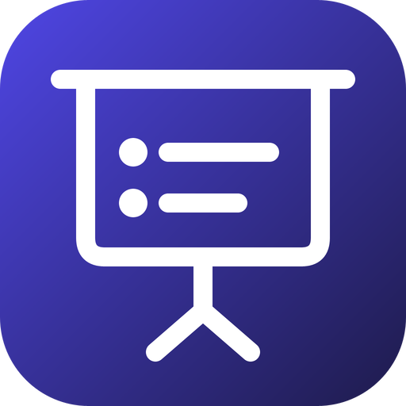
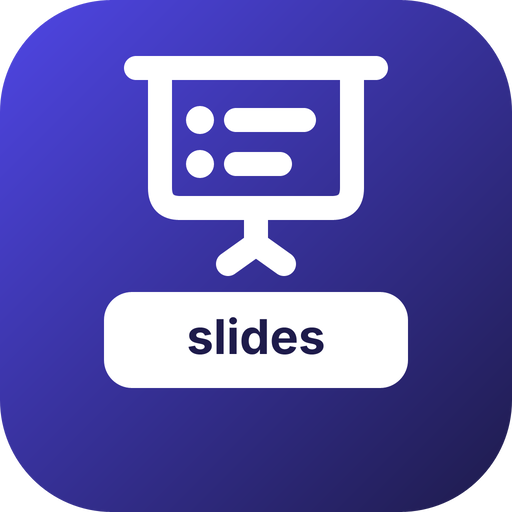

# go-slides — brand assets

Official logos for the **go-slides** organization.

 

## The mark

A slide on its stand: the screen hangs from its roller, two bullet points on
it, a tripod underneath. That is what the organisation makes — a deck is a
document shown one page at a time.

⛔ **The colours are not chosen here.** go-slides joins the **document
family** — `go-odf`, `go-richdoc`, `go-rtf`, `go-docutils`, `go-ooxml`,
`go-tex` — and takes its gradient, `#4F46E5 → #1E1B4B`, with the grammar every
mark in that family shares: a 256 px plate at `rx="56"`, and a white line glyph
at `stroke-width="12"` with round caps and joins. A deck's planned PPTX and PDF
outputs go through go-ooxml and go-pdfkit, and its math through go-tex: the
family is the neighbourhood the code already lives in.

`go-slides-slides` is the mark of the `slides` repository: the same glyph,
smaller and higher, over a white name plate — the family's per-repository
convention, not a glyph of its own.

## Formats

For each of `go-slides` and `go-slides-slides`:

- **SVG** — `svg/color`, `svg/white` (white, transparent), `svg/black` (black, transparent)
- **PNG** 16→1024 px, 3 variants — `png/<variant>/<size>/`
- **JPG** (color, white background) — `jpg/<size>/`
- **ICO** (Windows) — `ico/`
- **ICNS** (macOS) — `icns/`
- **GitHub avatar** 512 px — `avatar/`
- **Social preview** 1280×640 (repo banner) — `social/`

`check/kit.py` counts the whole matrix, for both subjects, on every pull
request: a kit once lived for a week with three of its seven formats because
every existing check looked at something that was present.

---
*`svg/color/*.svg` are the sources; every other file is generated from them by
the fleet's Go brand pipeline (brandgen, with go-gfx and go-opentype) — rounded
square badge, line glyph, color / white / black variants.*
